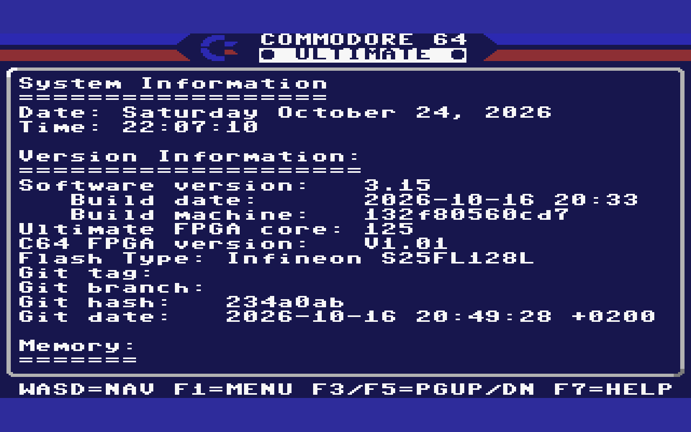
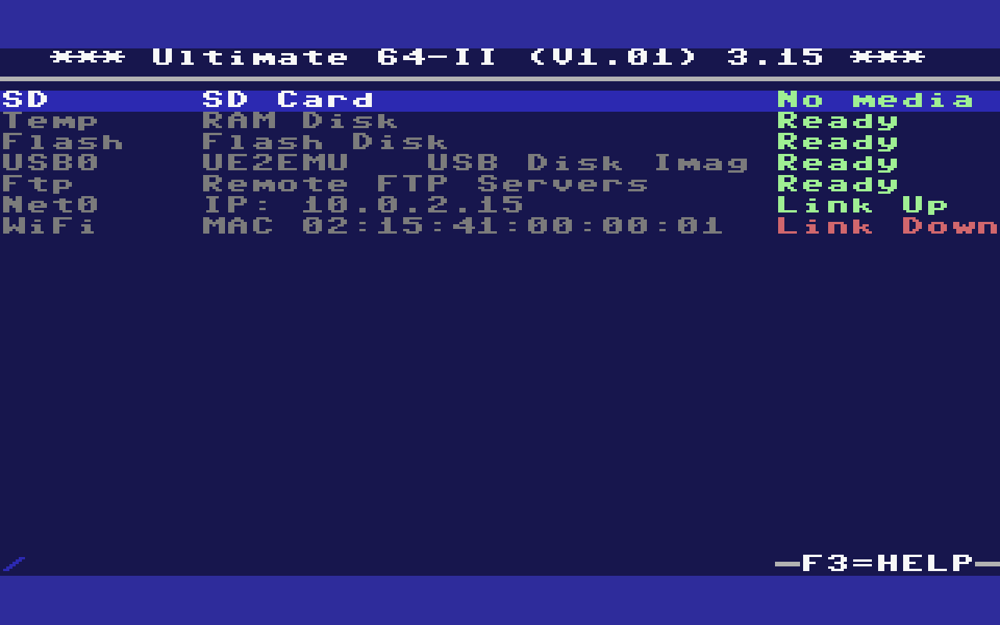
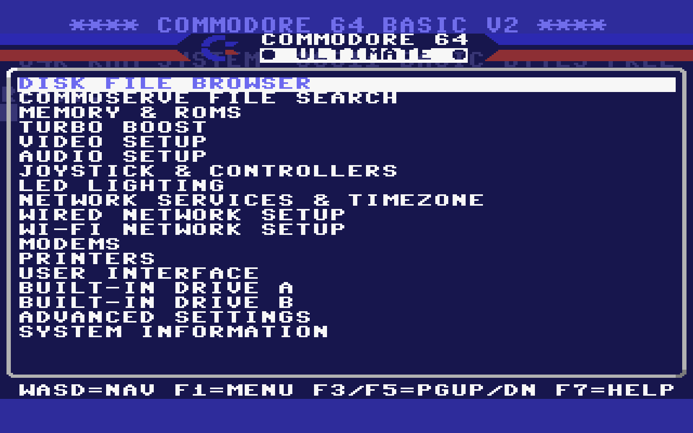
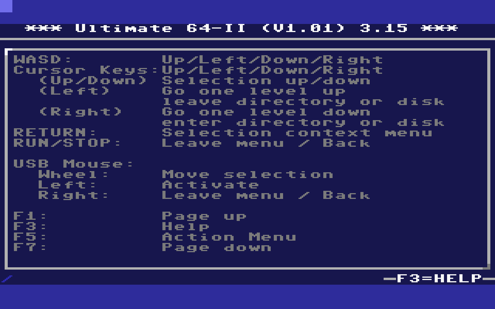

# 1. Basics

## Opening and closing the menu

| How | Effect |
|---|---|
| The machine's menu button | Opens the menu; pressing it again closes it |
| Menu button held longer than 1 s | Swaps to the next disk of a set instead of opening the menu |
| USB keyboard: SCROLL LOCK or F10 | Opens the menu; in the file browser also closes it |
| USB keyboard: CTRL+D | Swaps the disk without opening the menu |
| RUN/STOP (or left arrow, ESC) at the top level | Closes the menu |
| REST `PUT /v1/machine:menu_button` | Same as the button |

Outside the menu the C64 can be reset by holding the reset switch up for one second.

Holding RESTORE while switching on starts in safe mode: the settings are the defaults and the
flash disk is not mounted.

## The two looks

The menu has two looks, chosen with **User Interface** in the user interface settings
([4. Settings](04-settings.md#user-interface-settings)). **Automatic** (the default) picks the
Commodore look on a C64 Ultimate and the Ultimate look on an Ultimate 64 Elite II.

**Commodore look.** The menu opens on a main menu of large entries:

| Entry | Opens |
|---|---|
| DISK FILE BROWSER | The file browser ([2.](02-file-browser.md)) |
| COMMOSERVE FILE SEARCH | The Assembly64/CommoServe search form (needs a network link) |
| MEMORY & ROMS | Memory Configuration |
| TURBO BOOST | Turbo Settings |
| VIDEO SETUP | Video Configuration |
| AUDIO SETUP | A list: Audio Mixer, Speaker Mixer, SID Sockets Configuration, UltiSID Configuration, SID Addressing, SID Player Behavior |
| JOYSTICK & CONTROLLERS | Joystick Settings |
| LED LIGHTING | LED Lighting |
| NETWORK SERVICES & TIMEZONE | Network Settings |
| WIRED NETWORK SETUP | Ethernet Settings |
| WI-FI NETWORK SETUP | WiFi settings |
| MODEMS, PRINTERS, BUILT-IN DRIVE B | Nothing on this bitstream: the hardware behind them is not there ([10.](10-differences.md)) |
| USER INTERFACE | User Interface Settings |
| BUILT-IN DRIVE A | Drive A Settings |
| ADVANCED SETTINGS | The complete settings tree (as F2) |
| SYSTEM INFORMATION | Versions, flash type, memory, network |

SYSTEM INFORMATION (F4 in both looks):

**Ultimate look.** The menu opens directly in the file browser:

Both looks lead to the same settings pages and actions.

## Freeze and Overlay

**Interface Type** in the user interface settings decides where the menu appears:

- **Overlay on HDMI** (default): the menu is drawn over the HDMI picture; the C64 keeps running
  underneath. Without an HDMI monitor the menu falls back to Freeze.
- **Freeze**: the machine stops while the menu is open. On our bitstream the frozen picture stays
  visible behind the menu; **Overlay Transparency** (0, 25, 50 or 75 %) sets how much of it shows.

The machine is stopped without any bus cycle: nothing is written into C64 memory to show the menu.
Timewarp ([7.](07-timewarp.md)) works only from the Freeze menu.

Telnet (port 23) shows the same menus in a terminal, always in the Ultimate look.

## Keys

The F keys depend on the look:

| Key | Ultimate look | Commodore look |
|---|---|---|
| F1 | Page up | Action menu |
| F3 | Help | Page up |
| F5 | Action menu | Page down |
| F7 | Page down | Help |
| F2 | Settings (all) | Settings (all) |
| F4 | System information | System information |
| F6 | Assembly64 search | Assembly64 search |
| F8 (SHIFT+F7) | Close one level | Close one level |

Keys that work in the file browser and in every list:

| Key | Effect |
|---|---|
| Cursor up/down | Move the selection (with Navigation Style "WASD Cursors" also W/S) |
| Cursor right | Enter a folder, disk image or settings page |
| Cursor left | One level up |
| RETURN | Context menu of the selected item; on a setting: its values |
| SPACE | Select or deselect an item |
| C= A / C= N | Select all / none |
| C= C / C= V | Copy the selection / paste it here |
| INST (SHIFT+DEL) | Delete the selected files (asks first) |
| HOME | Go to the home directory; C= HOME makes the current folder the home directory |
| Letters | Jump to the first name that starts with them (`?` is a wildcard); with WASD cursors hold SHIFT |
| RUN/STOP, left arrow | Back; at the top closes the menu |
| C= L | Show the debug log |
| C= J | Swap the joystick ports: **no effect in this version** ([10.](10-differences.md)) |
| C= I | Swap Freeze and Overlay (Ultimate look) |
| C= O | Open the monitor `trxmon` ([6.](06-monitor.md)) |

These work in every menu:

| Key | Effect |
|---|---|
| C= R | Reset the C64 |
| C= Z | Reboot the C64 (cartridge and KERNAL start again) |
| C= B | Power cycle (asks first) |
| C= K | Power off (asks first) |

A USB mouse moves the selection with the wheel; left button activates, right button goes back.

The help page (F3 or F7) shows the keys:

## Keys held at power-on

| Keys | Effect for this power-on only |
|---|---|
| CTRL+P / CTRL+N | System Mode PAL / NTSC |
| CTRL+B / CTRL+S / CTRL+F | C64U Model Basic Beige / Starlight / Founders (the case light pattern) |
| RESTORE | Safe mode (see above) |

The settings page shows "(boot key)" behind a value set this way; it is not saved.
