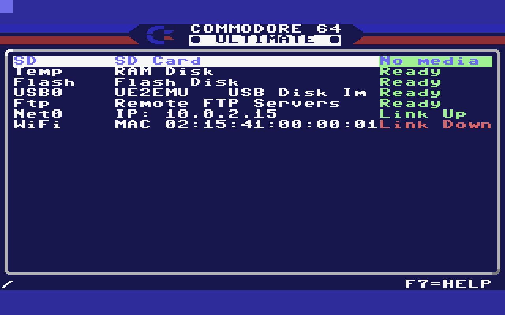
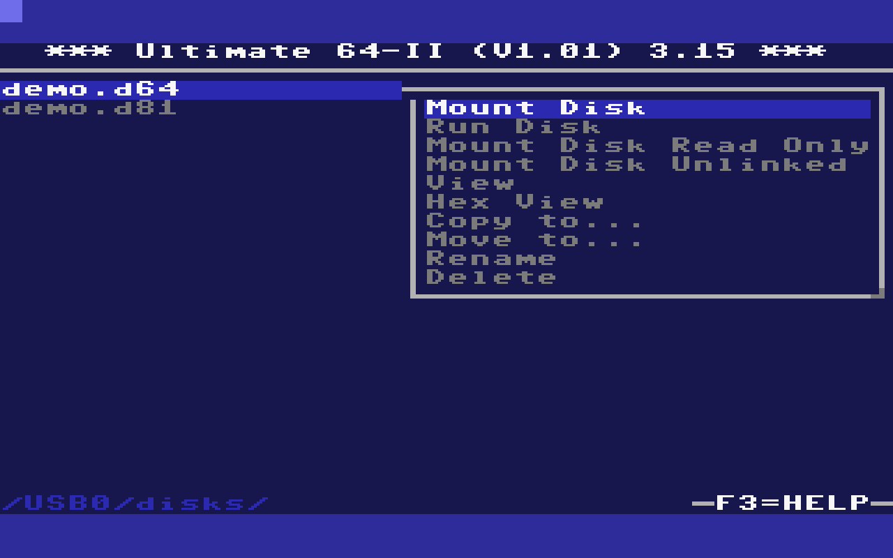
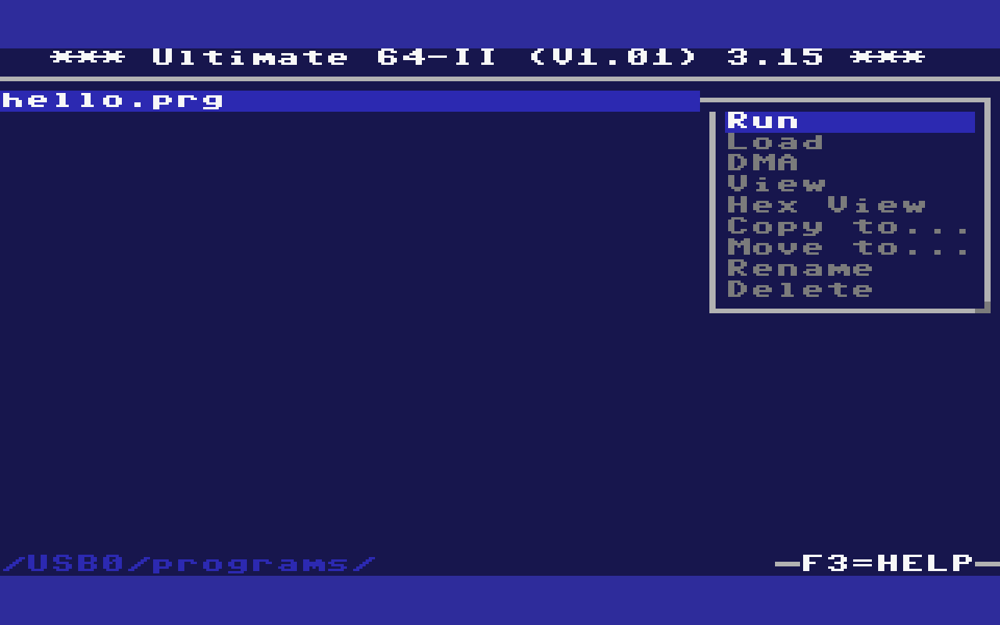
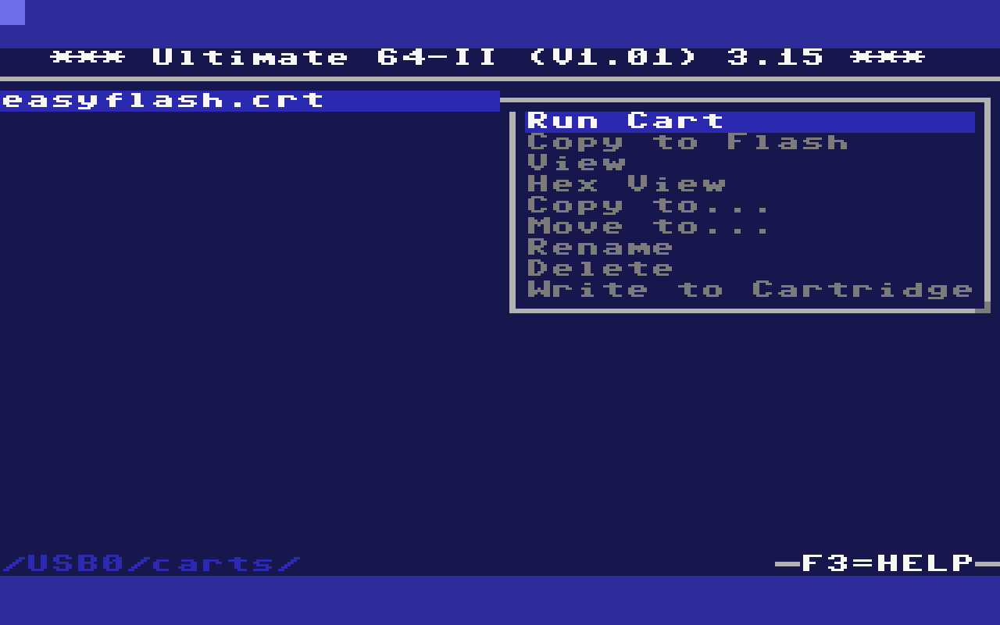
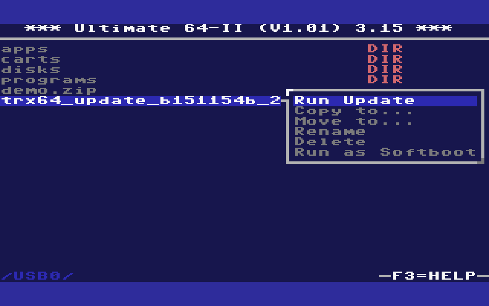
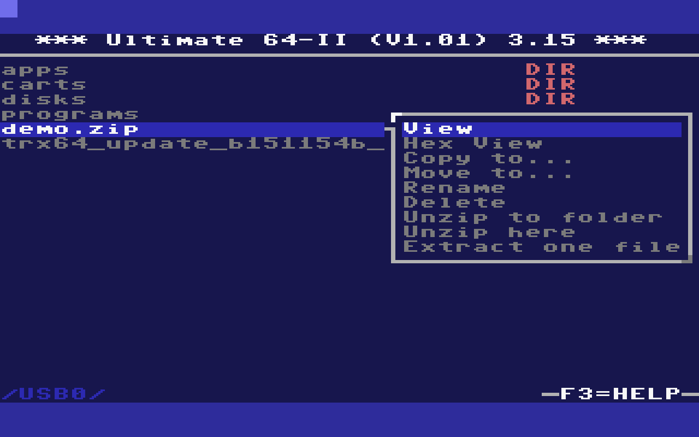

# 2. File browser

## Drives

| Entry | What it is |
|---|---|
| SD | The SD card |
| Usb0, Usb1, ... | USB sticks, one entry per partition |
| Flash | The internal flash disk: settings files, installed apps (`/Flash/apps`), the registry (`/Flash/config`), cartridges copied to flash. Not mounted in safe mode |
| Temp | A RAM disk; empty after power-off |
| Ftp | Saved FTP servers; their files appear like a drive |
| Net0, WiFi | Network interfaces with their address and link state (information only) |

The bottom line shows the current path.

## What every file and folder offers

RETURN opens the context menu. Every entry has, after its type's own entries:

| Entry | When | Effect |
|---|---|---|
| Enter | folders | Opens the folder |
| View / Hex View | files up to 256 KB | Text or hex viewer |
| Copy to... | | Pick a target folder; asks before overwriting |
| Move to... | writable drive | Pick a target folder |
| Rename | writable drive | Asks for the new name |
| Delete | writable drive | Asks, then deletes (folders with their content) |
| Run with App | a program `/Flash/apps/<EXT>.prg` exists for the extension | Loads the file into REU memory and starts that program |

Entries added by installed apps follow at the end ([8. Apps](08-apps.md)).

## Per file type

**Disk images (.d64, .g64)**

| Entry | Effect |
|---|---|
| Mount Disk | Puts the disk into drive A; the next disk of a set is found in the same folder |
| Run Disk | Mounts it and runs `LOAD"*",8,1` and RUN |
| Mount Disk Read Only | The C64 cannot write to it |
| Mount Disk Unlinked | Writes stay in memory and do not go back to the file |
| Load into MP3 Drv A..D | Only when that REU RAM drive is set up for this image type |

The Commodore look shows Run Disk first. Disk images open like folders (cursor right) and list
their files; a program inside offers **Mount & Run** (mount, then load over DMA and run) and
**Real Run** (mount, then a real `LOAD` over the serial bus and run).

`.d71`, `.d81` and `.dnp` cannot be mounted: the drive is a 1541 only. `.g71` mounts as a 1541
disk.

**Programs (.prg, .p00)**

| Entry | Effect |
|---|---|
| Run | Loads the program into memory over DMA and runs it |
| Load | Loads it, does not run it |
| DMA | Writes the bytes into memory; the menu stays open |

A `.cfg` file with the same name next to a program, disk or cartridge is loaded first, so a
program can bring its own settings.

**Cartridge images (.crt)**

| Entry | Effect |
|---|---|
| Run Cart | Loads the image and starts it (a changed previous cartridge is saved first if set so, [5.](05-cartridges.md)) |
| Copy to Flash | Copies the file to the flash disk and makes it the startup cartridge |
| Write to Cartridge | (`trex_crt` app) writes the image to a real flash cartridge in the port |

**Others**

| Type | Entries |
|---|---|
| .sid, .mus, .str | Play Main Tune, Show Info, Play Song n (one per subtune) |
| .mod | Play MOD (through Ultimate Audio); Preload on Startup |
| .reu | Load into REU (refused while a cartridge image occupies the REU memory); Preload on Startup |
| .t64 | Opens like a folder |
| .bin, .rom, .64c | Set as Char ROM (4 KB); Set as Kernal ROM, Set as Basic ROM, Load Kernal (8 KB); Load Drive ROM, Set as 1541 ROM (16/32 KB) |
| .cfg | Load Settings |
| .vpl | Apply Palette, Set as Default |
| .u2a | Run App ([8.](08-apps.md)) |
| .cfw, .ue2 | Run Update ([INSTALL.md](../../INSTALL.md)); Run as Softboot (`softboot` app) |
| .zip | Unzip to folder, Unzip here, Extract one file (`unzip` app) |
| .tap | Nothing: there is no tape port on this bitstream |

