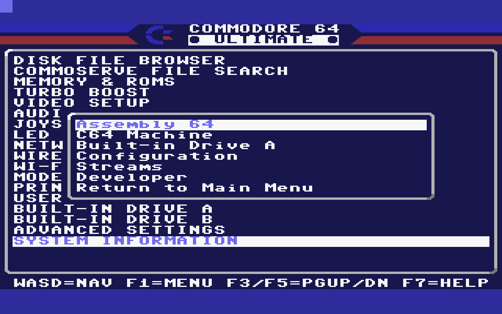
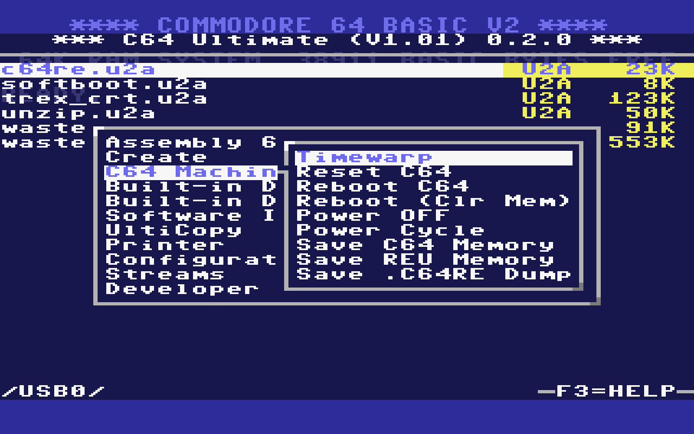
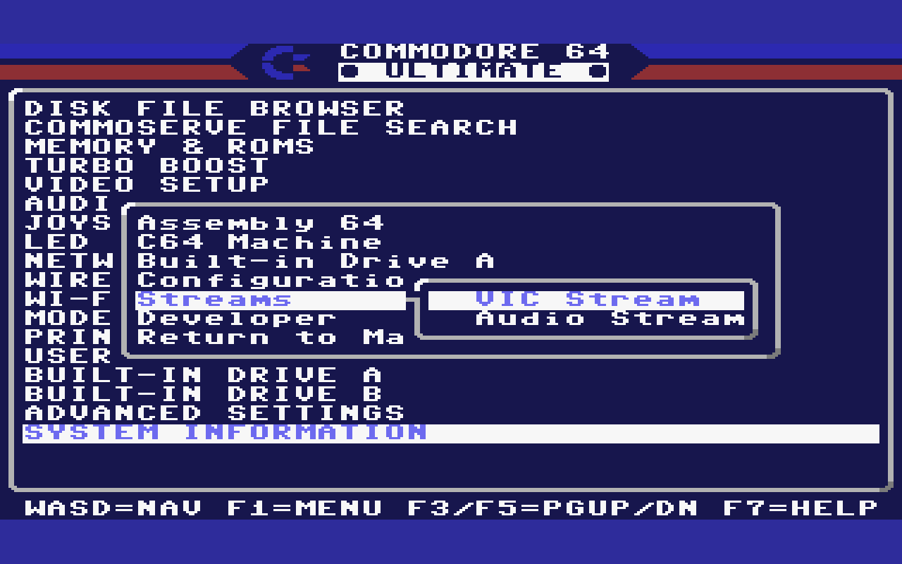
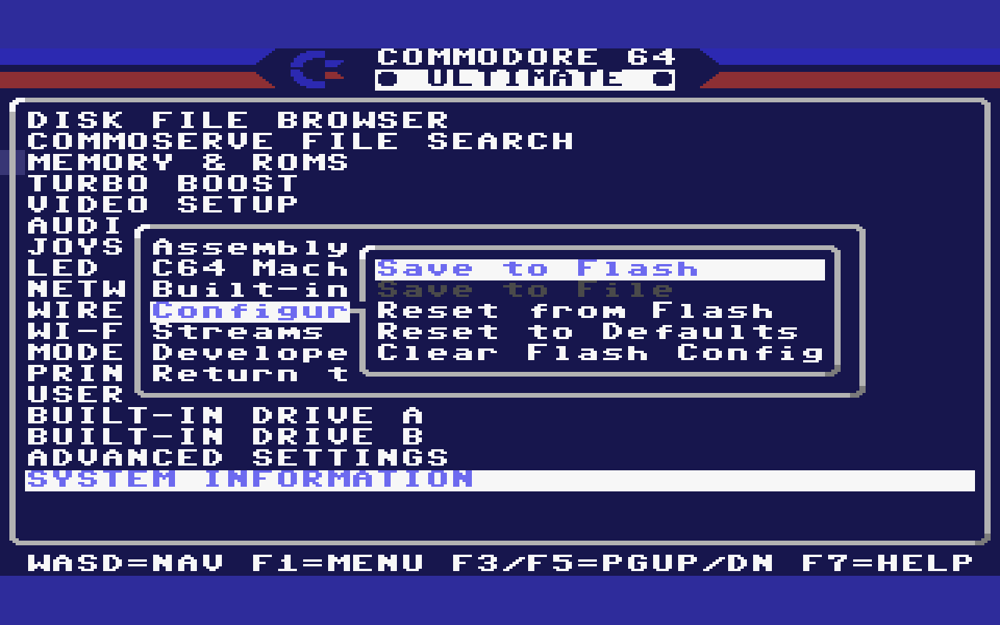
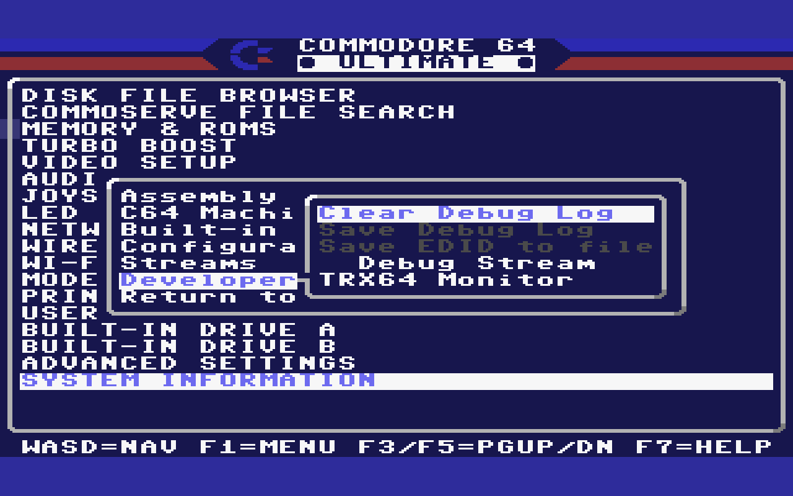

# 3. Action menu

F5 in the Ultimate look, F1 in the Commodore look. A category with only one entry runs it at once.

## Assembly 64

| Entry | Effect |
|---|---|
| New Search | The Assembly64 (Ultimate look) or CommoServe (Commodore look) search form. Needs a network link |

## Create

Shown when the current folder is writable.

| Entry | Effect |
|---|---|
| Directory | A new folder (asks for the name) |
| D64 Image, G64 Image, D71 Image, G71 Image, D81 Image, D81 (81 Tr.), DNP Image | A blank disk image in this folder |

## C64 Machine

| Entry | When | Effect |
|---|---|---|
| Timewarp | Freeze menu, our bitstream | The Timewarp bar ([7.](07-timewarp.md)) |
| Save State | the ring holds a frame | The machine and its medium as one `.c64re`, beside the image that is running ([7.](07-timewarp.md)) |
| Reset C64 | | Reset; the menu closes |
| Reboot C64 | | Cold start of cartridge and KERNAL |
| Reboot (Clr Mem) | | Clears the RAM, then reboots |
| Power OFF | | Switches the machine off |
| Power Cycle | | Off and on |
| Save C64 Memory | writable folder | The 64 KB RAM as a `.bin` file (asks for the name) |
| Save REU Memory | writable folder | The REU as a `.reu` file |
| Save Cartridge | a cartridge image is loaded | Writes the cartridge with its flash and EEPROM changes to a `.crt` and makes that file its source |
| Save MP3 Drv A..D | that RAM drive is set up | Saves it as a disk image |
| Dump Cartridge, Cart Inspector, Flash Cartridge | `trex_crt` installed | The cartridge tool ([5.](05-cartridges.md)) |

## Built-in Drive A

| Entry | When | Effect |
|---|---|---|
| Turn On / Turn Off | | Drive power |
| Reset | drive on | Resets the drive |
| Remove Disk | a disk is in | |
| Save as Binary / Save as GCR | a disk is in, writable folder | Saves the disk in the drive as `.d64` or `.g64` |
| Insert Blank | no disk | A blank formatted disk |

## Streams

| Entry | Effect |
|---|---|
| VIC Stream | Starts or stops the video stream (UDP, target in Data Streams settings) |
| Audio Stream | Starts or stops the audio stream |

A running stream is marked with an arrow in front of its name.

## Configuration

| Entry | Effect |
|---|---|
| Save to Flash | Saves all settings |
| Save to File | Saves all settings as a `.cfg` in the current folder |
| Reset from Flash | Discards unsaved changes |
| Reset to Defaults | All settings to their defaults (not saved until Save to Flash) |
| Clear Flash Config | Erases the saved settings |

## Developer

| Entry | Effect |
|---|---|
| Clear Debug Log / Save Debug Log | The firmware's log (C= L shows it) |
| Save EDID to file | The connected monitor's EDID as a `.bin` |
| Debug Stream | No effect: our bitstream has no debug stream (the Timewarp ring and `trxmon` replace it) |
| TRX64 Monitor | Opens the monitor ([6.](06-monitor.md)); part of the firmware, always there |

## Return to Main Menu

Commodore look only: back to the main menu.
