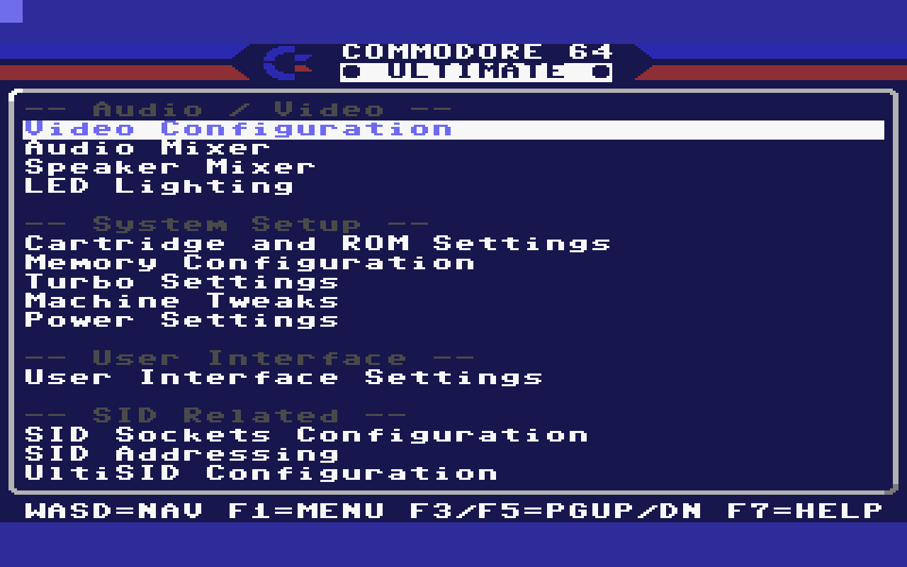
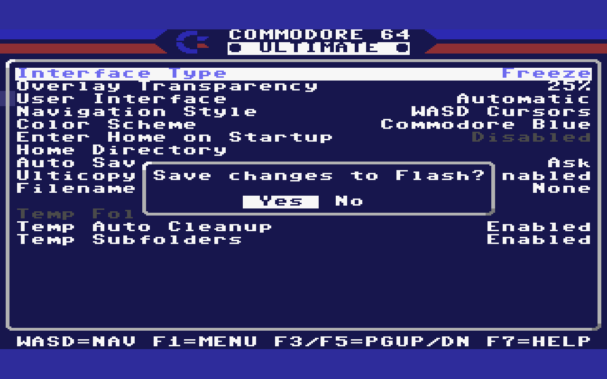
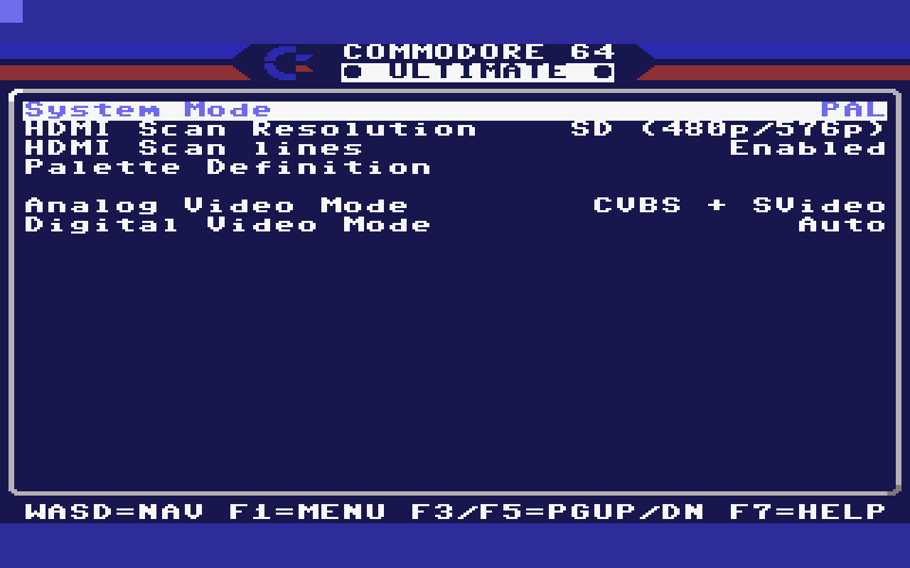
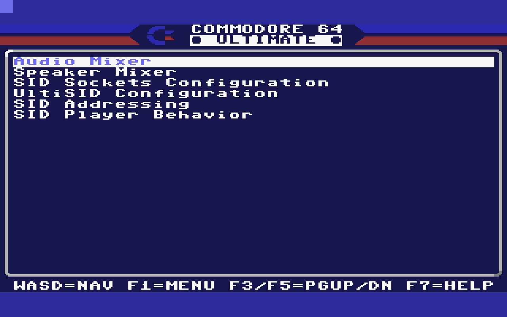
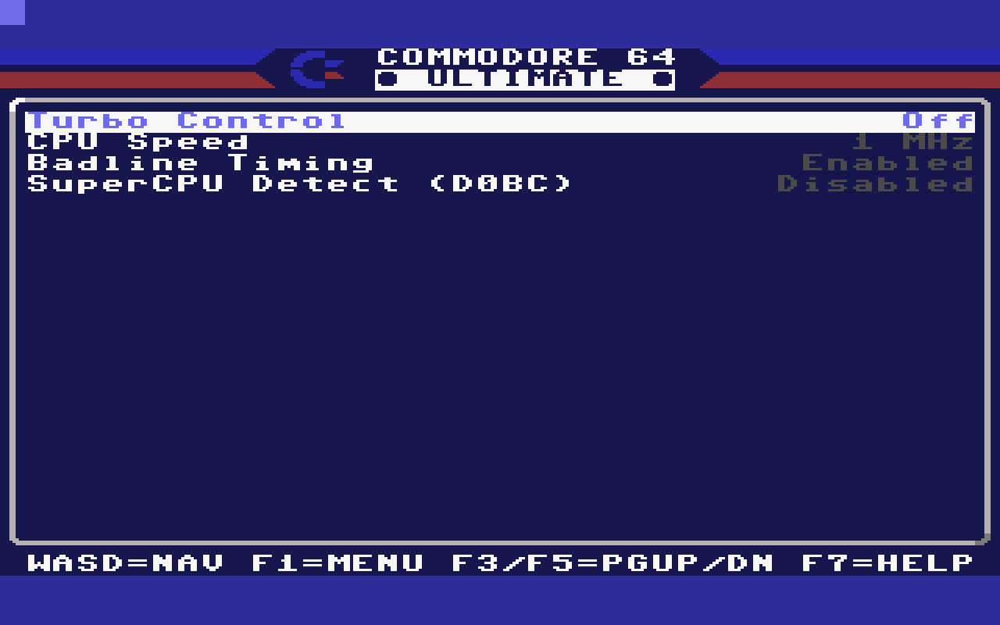
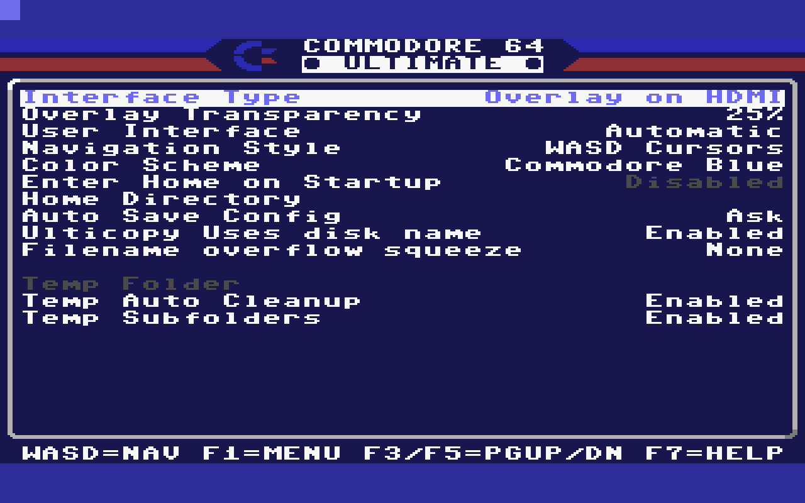
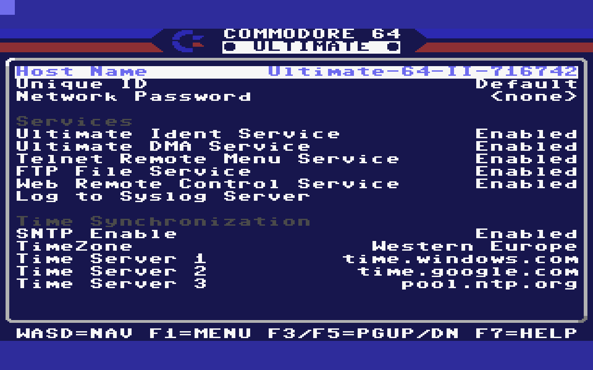

# 4. Settings

F2 opens the complete settings tree; in the Commodore look the main menu opens single pages and
**ADVANCED SETTINGS** opens the tree.

RETURN on an item opens its values; a letter jumps to the first value starting with it. Changes take
effect when you leave the page. **Auto Save Config** decides whether they are written to flash
(Ask shows this question):

Greyed items are shown but cannot be changed. Items marked **no effect** are offered by the
application but do nothing on our bitstream (the hardware behind them is not built, see
[10.](10-differences.md)).

While a cartridge is in the port or a cartridge image is loaded, **RAM Expansion Unit**,
**Ultimate Audio** and **Command Interface** show "Disabled (cartridge)" and cannot be changed
("Off while a cartridge runs."). They are off while the cartridge runs; your saved values come back
when it is gone.

## Audio / Video

### Video Configuration

| Item | Values | Default | Effect |
|---|---|---|---|
| System Mode | PAL, NTSC, PAL-60, NTSC-50, PAL-60/L, NTSC-50/L | PAL | Video timing of the C64. CTRL+P / CTRL+N at power-on choose PAL / NTSC once |
| HDMI Scan Resolution | SD, HD, FullHD, PC 800x600, 1024x768, 1280x1024 | SD | **No effect**: the HDMI output is always 1080p |
| HDMI Scan lines | Disabled, Enabled | Enabled | Darkens every other line |
| Palette Definition | a `.vpl` file, empty = built-in | empty | The C64 colours |
| Analog Video Mode | CVBS + SVideo, RGB | CVBS + SVideo | **No effect**: no analog video out |
| Digital Video Mode | Auto, HDMI, DVI | Auto | **No effect**: always HDMI |

### Audio Mixer

In the Commodore look **AUDIO SETUP** lists the audio pages:

21 items: a volume and a pan for each source.

| Item | Values | Default |
|---|---|---|
| Vol Master | OFF, -42 dB ... +6 dB | 0 dB |
| Vol UltiSid 1, Vol UltiSid 2 (reSID8 1 / 2) | | 0 dB |
| Vol Socket 1, Vol Socket 2 (real SID chips) | | 0 dB |
| Vol Sampler L, Vol Sampler R (Ultimate Audio) | | 0 dB |
| Vol Drive 1/2, Vol Tape Read/Write | | OFF on a C64 Ultimate. **No effect**: no drive or tape sound |
| Pan UltiSID 1 / 2 | Left 5 ... Center ... Right 5 | Center |
| Pan Socket 1 / 2 | | Left 3 / Right 3 |
| Pan Sampler L / R | | Left 3 / Right 3 |
| Pan Drive 1/2, Pan Tape Read/Write | | **No effect** |

A source that is on is never rounded down to silence; OFF and a fully panned-away side are silent.

### Speaker Mixer

The built-in speaker. **Speaker Enable** (default Enabled) switches it; Disabled greys the rest.
Per-source volumes like the Audio Mixer: SIDs, sockets and sampler default OFF, drive -15 dB,
tape -36 dB (drive and tape: **no effect**).

### LED Lighting

| Section | Items | Effect |
|---|---|---|
| Power LED | Output 1 (default On), Output 2 (default Drive A Act): On, Off, Drive A Pwr, Drive A Act, USB Activity, Any Activity, IRQ Line, their inversions and combinations | The two case LEDs |
| Case Lights | LED Type, Strip Length, Mode, Pattern, Intensity, Color, Tint | **No effect**: the light effects are not in the bitstream |
| Keyboard Lights | Mode, Music Detect, Pattern, Brightness, Color, Tint | **No effect**; the keyboard LEDs stay dark, SHIFT LOCK lights amber while locked |

## System Setup

### Memory Configuration (MEMORY & ROMS)

| Item | Values | Default | Effect |
|---|---|---|---|
| Kernal ROM, BASIC ROM, Character ROM | a file from the ROM folder | kernal.bin, basic.bin, chars.bin | The C64's ROMs |
| Cartridge | a `.crt`, empty = none | empty | Cartridge image loaded at start and reset |
| Save Changed Cartridge | Off, Ask, Auto | Ask | Writes flash and EEPROM changes of a cartridge image back to its file ([5.](05-cartridges.md)) |
| RAM Expansion Unit | Disabled, Enabled, GeoRAM Mode | Disabled | The REU. **While the REU is on, the Timewarp ring is off** |
| Size | 128 KB ... 16 MB | 2 MB | REU size |
| Command Interface | Disabled, Enabled | Disabled | The Ultimate Command Interface at $DF1C |
| Ultimate Audio | Disabled, Enabled | Disabled | The sampler at $DF20-$DFFF |
| Drive A: ROM for 1541 mode | a file | 1541.rom | The drive ROM. The 1571 and 1581 entries are greyed: the drive is a 1541 only |

### Cartridge and ROM Settings

The same items as above plus:

| Item | Values | Default | Effect |
|---|---|---|---|
| Cartridge Preference | Auto, Internal, External, Manual | Auto | Auto: a cartridge in the port wins over the internal one. External: the port only. Internal: the internal one only (a real cartridge stays switched off). Manual: per resource with the four Bus Sharing items |
| Bus Operation Mode | Quiet, Writes, Dynamic, Dyn. & Writes, Compatibility | Quiet | **No effect**: our port drives the bus whenever a cartridge needs it |
| Bus Sharing - ROMs / I/O1 / I/O2 / Interrupts | Internal, External, Both | Both | Only with Cartridge Preference Manual |
| GAME/EXROM | On, Off | On | Off hides a real cartridge completely |
| Fast Reset | Disabled, Enabled | Disabled | Skips the KERNAL RAM test |
| REU Preload, REU Preload Image, REU Preload Offset | | Disabled, /Usb0/preload.reu, 0 KB | Loads an image into the REU at start (refused while a cartridge image is loaded: it uses the REU memory) |
| DMA Load Mimics ID: | 8 ... 31 | 8 | The device number a DMA load reports |

The cartridge tool needs Cartridge Preference **Auto** or **External** and the cartridge plugged in
before the C64 was last reset ([5.](05-cartridges.md)).

### Turbo Settings (TURBO BOOST)

| Item | Values | Default | Effect |
|---|---|---|---|
| Turbo Control | Off, Manual, U64 Turbo Registers, TurboEnable Bit | Off | Off: 1 MHz, the rest greyed. Manual: the CPU Speed below. The other two let programs switch the speed through the U64 turbo registers or the TurboEnable bit |
| CPU Speed | 1, 2, 3, 4, 6, 8, 10, 12, 14, 16, 20, 24, 32, 40, 48, 64 MHz | 1 | The 6510's speed |
| Badline Timing | Disabled, Enabled | Enabled | Enabled: the CPU waits on badlines as at 1 MHz |
| SuperCPU Detect (D0BC) | Disabled, Enabled | Disabled | Answers the SuperCPU detection at $D0BC |

### Machine Tweaks

| Item | Values | Default | Effect |
|---|---|---|---|
| C64U Model | Basic Beige, Starlight Edition, Founders Edition | Starlight | Greyed; set by CTRL+B / S / F at power-on |
| Burst Mode Patch, Parallel Cable to Drive A, Serial Bus Mode | | Off, Disabled, All Connected | **No effect** |

### Power Settings

| Item | Values | Default | Effect |
|---|---|---|---|
| Power On After Power Loss | Off, On, Last State | Off | What the machine does when mains power returns |
| Wake On Wi-Fi | Disabled, Enabled | Disabled | A Wi-Fi magic packet switches the machine on (the wired jack is off with the machine) |

Both live in the machine's control module, not in the settings flash.

## User Interface Settings

| Item | Values | Default | Effect |
|---|---|---|---|
| Interface Type | Freeze, Overlay on HDMI | Overlay on HDMI | Where the menu appears ([1.](01-basics.md#freeze-and-overlay)) |
| Overlay Transparency | 0%, 25%, 50%, 75% | 25% | How much of the frozen picture shows behind the Freeze menu |
| User Interface | Automatic, Ultimate, Commodore | Automatic | The look |
| Navigation Style | Quick Search, WASD Cursors | WASD Cursors on a C64 Ultimate | Typing jumps to names, or W/A/S/D move |
| Color Scheme | Standard Blue, Ultimate Black, C128 Style, Commodore Blue, Commodore 1-3 | Commodore Blue on a C64 Ultimate | Menu colours |
| Enter Home on Startup, Home Directory | | Disabled, empty | Open the file browser in the home folder (Ultimate look) |
| Auto Save Config | No, Ask, Yes | Ask | Save changes to flash when leaving the settings |
| Ulticopy Uses disk name | | Enabled | No effect: there is no UltiCopy on this bitstream |
| Filename overflow squeeze | None, Beginning, Middle, End | None | Where long names are shortened |
| Temp Auto Cleanup, Temp Subfolders | | Enabled | Housekeeping of the Temp folder |

## SID Related

### SID Sockets Configuration

| Item | Values | Default | Effect |
|---|---|---|---|
| SID Socket 1 / 2 | Disabled, Enabled | from detection | Power and use of a real SID chip in the socket |
| SID Detected Socket 1 / 2 | (read only) | | 6581, 8580, FPGASID, SwinSID Ultimate, ARMSID, ARM2SID, SidFx, PDsid, SIDKick ... |
| SID Socket 1 / 2 1K Ohm Resistor | Off, On | Off | Load resistor |
| SID Socket 1 / 2 Capacitors | (read only) | | 470 pF or 22 nF |

A detected chip with its own options (FPGASID, SwinSID, ARMSID, PDsid, SIDKick) gets an extra page
"SID Socket n: chip".

### SID Addressing

| Item | Values | Default | Effect |
|---|---|---|---|
| SID Socket 1 / 2 Address | Unmapped, $D400-$D7E0, $DE00-$DFE0 | $D400 | Address of each real SID |
| Ext DualSID Range Split | Off, A5 ... A9 | Off | Address bit that splits a dual SID |
| reSID8 1 / 2 Address | as above | $D400 | Base address of each of the two reSID8 engines |
| reSID8 Range Split | Off, 1/2 (A5) ... 1/4 (A7,A8) | Off | Splits an engine's range into 2 or 4 SIDs: with both engines up to 8 SIDs |
| Paddle Override | Disabled, Enabled | Enabled | Paddle lines (also in Joystick Settings) |
| Auto Address Mirroring | Disabled, Enabled | Enabled | Fills unused mirrors |
| Visual SID Address Editor | | | An editor for all addresses at once |

### UltiSID Configuration (the reSID8 page)

On our bitstream this page holds the settings of the reSID8 engines (it keeps the old title in
the list). Each item exists for engine 1 and engine 2.

| Item | Values | Default | Effect |
|---|---|---|---|
| reSID8 n Chip Model | 6581, 8580 | 6581 | The chip the engine emulates |
| reSID8 n Filter | On, Off | On | Off bypasses the filter |
| reSID8 n Filter Curve | Chip Model, 6581 Follin, 6581 Galway, 6581 Average, 6581 Strong, 6581 Extreme, 6581 Custom, 8580 | Chip Model | The filter curve; Chip Model follows the chip model |
| reSID8 n 6581 Base | 0 ... 511 | 245 | Only for 6581 Custom |
| reSID8 n 6581 Offset | -1024 ... 1023 | -780 | Only for 6581 Custom |
| reSID8 n Filter Resonance | Auto, Low, High | Auto | Auto follows the chip model |
| reSID8 n Digis Level | Auto, Off, Low, Medium, High | Auto | Volume of sample playback through the volume register |

### SID Player Behavior

| Item | Values | Default | Effect |
|---|---|---|---|
| SID Player Autoconfig | Disabled, Enabled | Enabled | The SID player sets addresses and chip types itself |
| Allow Autoconfig uses reSID8 | No, Yes | Yes | It may use the reSID8 engines |

## Peripherals

### Drive A Settings (BUILT-IN DRIVE A)

| Item | Values | Default | Effect |
|---|---|---|---|
| Drive | Disabled, Enabled | Enabled | Drive power |
| Drive Type | 1541 | 1541 | 1571 and 1581 are not available |
| Drive Bus ID | 8 ... 11 | 8 | Device number |
| ROM for 1541 mode | a file | 1541.rom | Drive ROM |
| Extra RAM | Disabled, Enabled | Disabled | Extra RAM in the drive |
| Disk swap delay | 100 ... 1000 ms | 100 ms | Pause when swapping disks |
| Resets when C64 resets | No, Yes | Yes | |
| Freezes in menu | No, Yes | Yes | The drive stops while the menu is open |
| GCR Save Align Tracks | No, Yes | Yes | |
| Leave Menu on Mount | No, Yes | Yes | |
| D64 Geos Copy Protection | none, Gaps, Track 36, Both | none | Emulates GEOS copy protection on D64 images |
| Track Twist | 0 ... 4000 | 2700 | Track skew when a D64 is converted |

### Joystick Settings (JOYSTICK & CONTROLLERS)

| Item | Values | Default | Effect |
|---|---|---|---|
| Joystick Input | Normal, Swapped, WASD Port 2, WASD Port 1 | Normal | Port swap, or the keyboard as a joystick (hold CTRL to type W, A, S, D, RETURN) |
| Paddle Override | Disabled, Enabled | Enabled | |
| Mouse Mode | Cursor, Mouse, Mouse + Cursor, Mouse + Wheel | Mouse | How a USB mouse appears to the C64 |
| Mouse Sensitivity, Mouse Acceleration | 1 ... 16, Off/Adaptive | 8, Off | |
| Menu Mouse Navigation | Disabled, Enabled | Enabled | The mouse moves the menu selection |
| Mouse Wheel Sensitivity, Mouse Wheel Direction | 1 ... 16, Normal/Reversed | 8, Normal | |
| USB Mouse, USB Keyboard (+ HID Mode) | (read only) | | Detected devices |

## Network

### Network Settings (NETWORK SERVICES & TIMEZONE)

| Item | Values | Default | Effect |
|---|---|---|---|
| Host Name | text | from the machine | Name on the network |
| Unique ID | Default, or entered | Default | ID in the discovery answer |
| Network Password | text | none | Protects REST, FTP, Telnet |
| Ultimate Ident Service, Ultimate DMA Service, Telnet Remote Menu Service, FTP File Service, Web Remote Control Service | Disabled, Enabled | Enabled | The services of [9.](09-network.md) |
| Log to Syslog Server | address | empty | Sends the log to a syslog server |
| SNTP Enable, TimeZone, Time Server 1-3 | | Enabled, Western Europe, ... | Clock from the network. There is no battery clock: the time is set from the network at start |

### Ethernet Settings (WIRED NETWORK SETUP) and WiFi settings (WI-FI NETWORK SETUP)

Use DHCP (Enabled), Static IP, Netmask, Gateway, DNS (used when DHCP is off), then status, IP
address and MAC. WiFi adds the actions Enable, Disable, Disconnect, Connect to last AP, Select AP
from list, Enter AP manually, Forget APs.

### Data Streams

| Item | Default | Effect |
|---|---|---|
| Stream VIC to | 239.0.1.64:11000 | Target of the video stream |
| Stream Audio to | 239.0.1.65:11001 | Target of the audio stream |
| Stream Debug to, Debug Stream Mode | | **No effect** |

## Not in the menu

Some items are reachable only over REST (`/v1/configs`), for example "UserPort Power Enable" and
"Adjust Color Clock"; on our bitstream neither has an effect.
