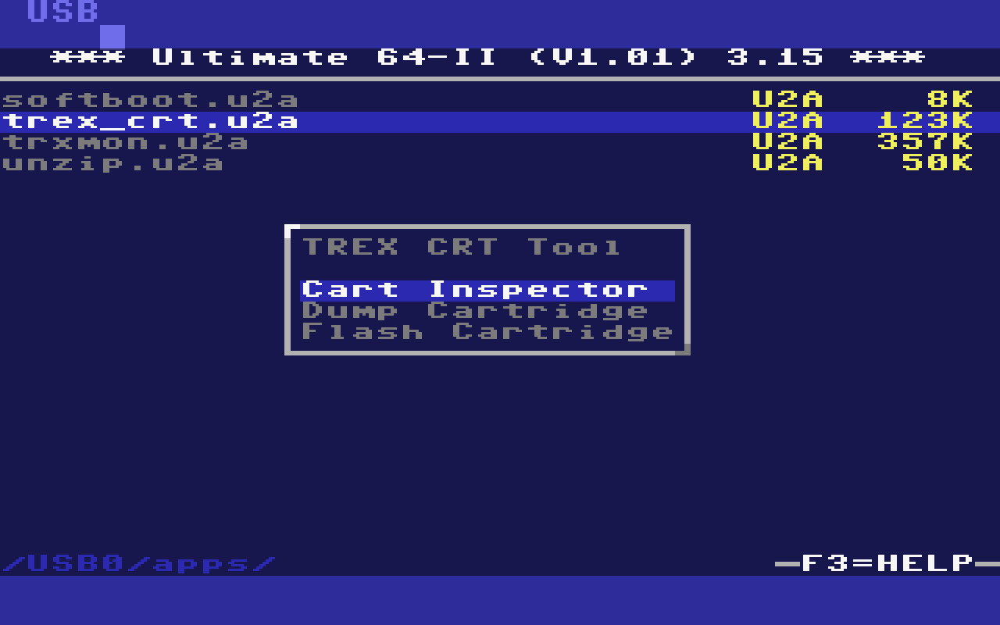

# 5. Cartridges

There are two kinds: **cartridge images** (`.crt` files the machine emulates) and **real
cartridges** in the expansion port. Only one runs at a time.

## Cartridge images

Start one with **Run Cart** in the file browser, or make it the startup cartridge with
**Cartridge** in Memory Configuration (or **Copy to Flash**).

Supported types: Normal 8K, 16K and Ultimax, Ocean, Simons' BASIC, C64 Game System, Dinamic,
Magic Desk, EasyFlash, EasyFlash 3 (all 8 slots, type 90), EasyFlash XL, MegaByter, 2MegaByter,
GMod2, C64MegaCart, Action Replay, Retro Replay. Other types load but stay off.

A cartridge image uses the REU memory: while one is loaded the REU, Ultimate Audio and the Command
Interface are off, and REU files cannot be loaded.

### Saving changes back to the file

Flash cartridges (EasyFlash, GMod2, MegaByter, C64MegaCart, ...) save games into their flash or
EEPROM. **Save Changed Cartridge** in Memory Configuration decides what happens with those changes:

| Value | Effect |
|---|---|
| Off | Nothing is saved; the next start of the file begins from the original |
| Ask (default) | When you open the menu after a change: "Cartridge changed. Save it to <file>?" Yes writes the file. No is remembered until the next change |
| Auto | Written to the file in the background once the C64 has been quiet for 2 seconds (at the latest after 30 s), and always before a reset, reboot, power off or another cartridge |

A file on a read-only drive cannot be updated; the menu says so once per change.
**C64 Machine > Save Cartridge** writes the current state to a new file at any time.

## Real cartridges in the port

Plug the cartridge in with the machine off. With **Cartridge Preference** Auto (the default) or
External the cartridge starts as on a C64. Tested: EasyFlash 1, EasyFlash 3, MegaByter, GMod2.

## The cartridge tool `trex_crt`

Dumps a real cartridge to a `.crt`, writes a `.crt` to a real flash cartridge, and shows a
cartridge's memory. It is an app ([8.](08-apps.md)): once installed it adds **C64 Machine > Dump
Cartridge / Cart Inspector / Flash Cartridge** and **Write to Cartridge** on `.crt` files. Started
with Run App it shows a chooser:

### Before you start

- The cartridge must have been in the port when the C64 was last reset, and **Cartridge
  Preference** must be Auto or External. Otherwise: "The port is not enabled. Set Cartridge
  Preference to Auto or External, reset the C64 and freeze again."
- A running program can switch its cartridge off (EasyFlash games often do). Then the tool says
  "No cartridge on the pins": reset, and open the menu right at the cartridge's start.
- When the tool ends after it touched the cartridge, it resets the C64: the cartridge starts again
  from its beginning.

Every tool shows a map of the banks (16 per row; ROML and ROMH rows for 16K and EasyFlash
cartridges), a status line and the keys. RUN/STOP leaves.

### Dump Cartridge

Keys: **F1** scan, **F3** dump, **F7** (EasyFlash 3) choose a slot or the whole cartridge.

The tool detects EasyFlash (type 32), EasyFlash 3 (one slot as type 32, or all 8 slots with the
system area as one type 90 file of 8 MB), MegaByter (86), C64MegaCart (88), GMod3 (62), GMod2 (60,
with its EEPROM), Ocean / Magic Desk (5), Super Games (8) and plain 8K/16K/Ultimax (0).

1. F3. It asks "Detected: <name>. Dump as type <n>?"; No offers a list of types to save as.
2. Pick the folder, then the file name (`.crt` is added). An existing file is overwritten only
   after asking.
3. The whole cartridge is read first, then written to the file. If writing fails: "Saving
   failed. Retry?" (Yes writes again without reading the cartridge again).
4. The status line ends with "Done: N bank(s), X KB saved."

### Flash Cartridge / Write to Cartridge

Keys: **F1** scan, **F3** write, **F5** verify, **F7** (EasyFlash 3) slot, whole cartridge or erase.

| Cartridge | Chip | CRT types |
|---|---|---|
| EasyFlash | 2 x AM29F040 (1 MB) | 32 |
| EasyFlash 3 | MX29LV640EB (8 MB) | 32 into one slot (1-7), 90 for the whole cartridge |
| GMod2 | AM29F040 (512 KB) + EEPROM | 60 |
| MegaByter | MX29F800CB (1 MB) | 86 |
| C64MegaCart | M29F160FT (2 MB) | 88 (19 from older dumps) |

The file is checked before the tool opens; a damaged or unsuitable CRT is refused with the reason.

- **F3 writes at once**: the chip (or, on an EasyFlash 3, only the chosen slot) is erased and
  programmed. There is no further question. F5 verifies afterwards.
- On an EasyFlash 3 a slot write ends with the slot's name for the EasyFlash menu.
- **Whole EasyFlash 3** (F7, then a type 90 file, F3): asks, then you type `WRITE`. Every slot
  including the system area is rewritten.
- **ERASE WHOLE CART...** (F7, EasyFlash 3): asks, then you type `ERASE`. All 8 MB are erased; the
  cartridge does not start until a system image is written back.
- The EAPI in an EasyFlash image is replaced by the driver for the detected chip.

Do not switch off or remove the cartridge while it writes.

### Cart Inspector

Shows the cartridge memory, 8 bytes per line, with the GAME/EXROM lines, `$01` and the bank.

| Key | Effect |
|---|---|
| Up / Down | Scroll by 8 bytes |
| Left / Right | Previous / next bank (written to $DE00) |
| F1 | Go to an address |
| F3 | Write a byte to an address (no question) |
| F5 | Set `$01` |
| F7 | Set `$DE00` |
| RUN/STOP | Leave |
