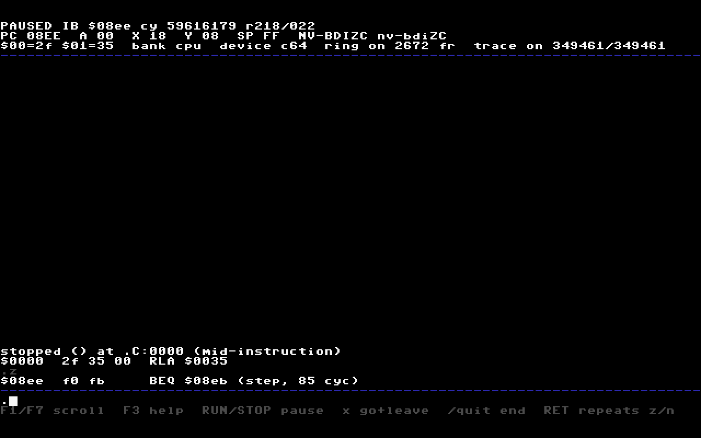
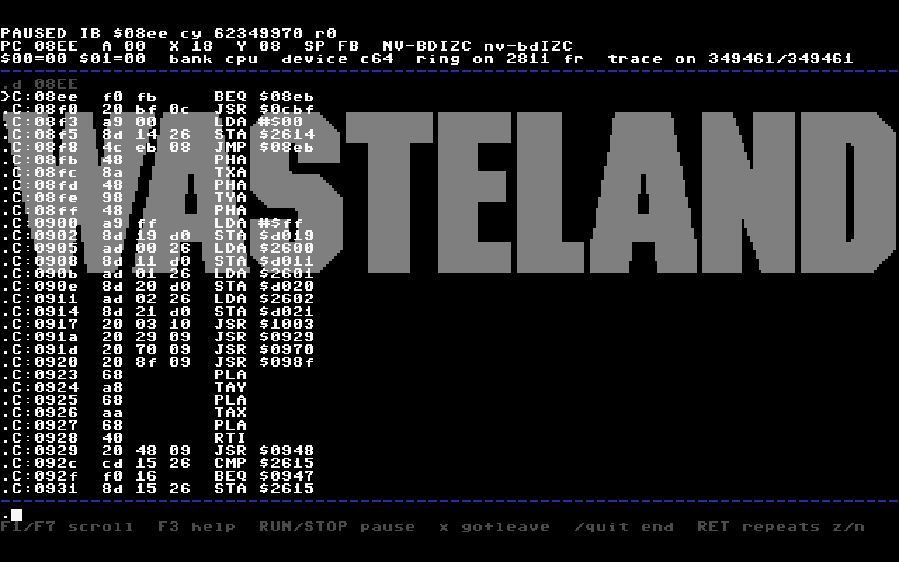
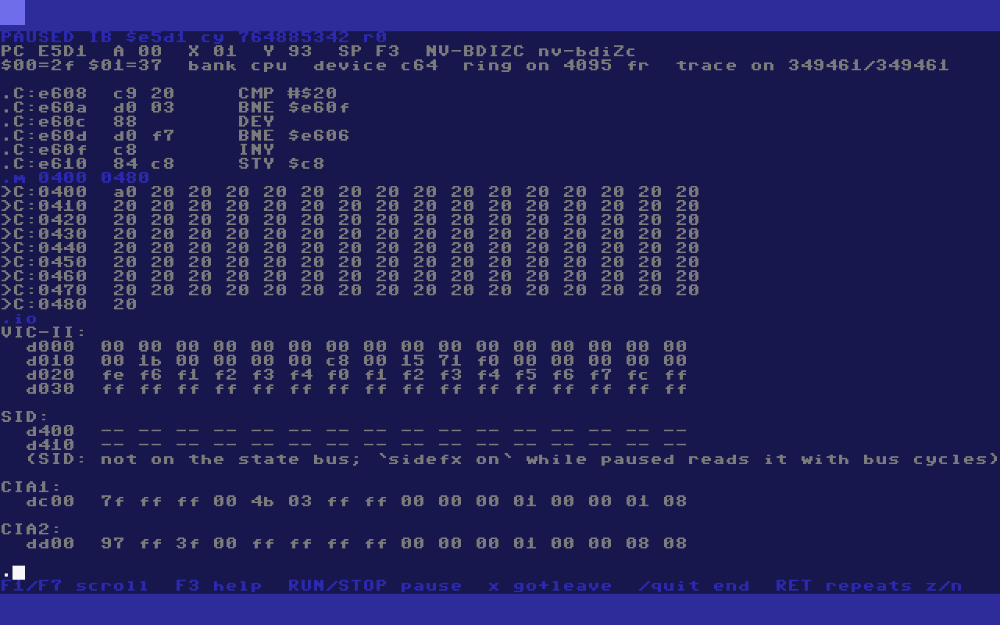
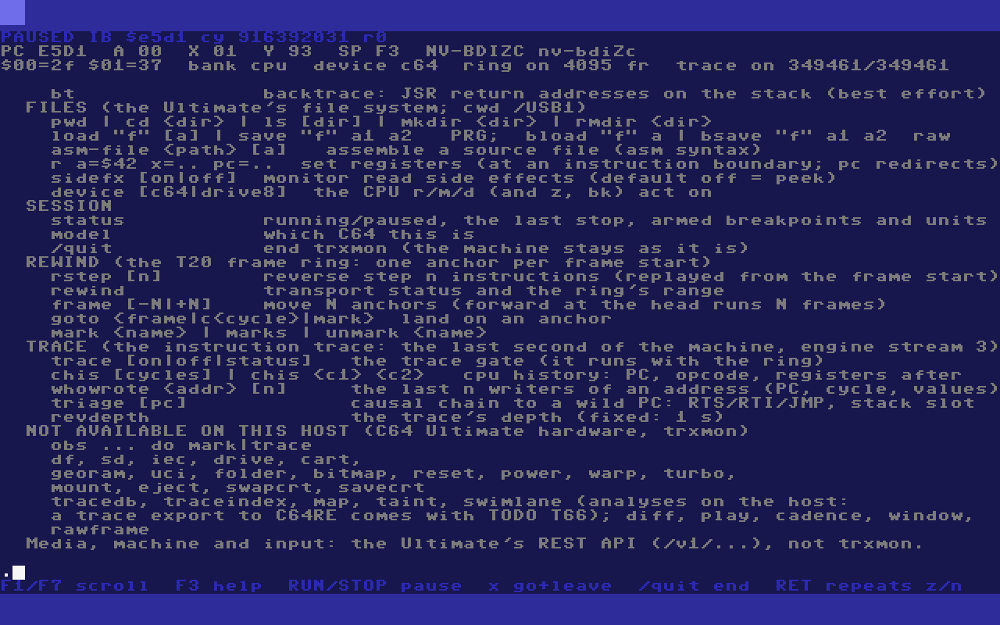

# 6. Monitor (`trxmon`)

`trxmon` is a machine-code monitor for the running C64. It stops the machine in the hardware, so it
never writes into C64 memory to do so: no BRK, no changed vectors. Its commands and output follow
the TRX64 emulator's monitor (VICE style). It needs our bitstream.

It also serves the C64RE debugger over the network, so C64RE connects to the C64 Ultimate as it
would to the TRX64 emulator.

## Starting and leaving

The monitor is part of the firmware; nothing has to be installed. Its service runs from the start,
holds the breakpoints and serves the network port whether a screen is open or not.

- **C= O** in the file browser, or
- **Developer > TRX64 Monitor** in the action menu, or
- **C= O** in Timewarp, which opens it on the frame the scrub bar is on ([7.](07-timewarp.md)).

The machine is paused at the next instruction. With the HDMI overlay the screen has 80 columns and
40 lines; in the Freeze menu on the C64's own screen it has 40 x 23.

| Line | Shows |
|---|---|
| Top | PAUSED at PC, cycle count and raster position, or RUNNING |
| 2 | Registers and flags |
| 3 | `$00`/`$01`, the memory view (lens), the device, the Timewarp ring and the trace |
| Bottom | The command line (`.` prompt) and the keys |

| Command | Leaves how |
|---|---|
| `x` | Runs the machine and closes the menu. The service keeps watching and brings the screen back when a breakpoint or an observer fires |
| `/quit` | Drops the RPC client and closes the screen; the service and the breakpoints stay |

## Keys

| Key | Effect |
|---|---|
| RETURN | Runs the line. An empty line repeats the last step, or continues `m` and `d` |
| Cursor up / down | Command history |
| Cursor left / right, HOME | Move in the line |
| Left arrow | Clears the line |
| Page keys (F1/F7 Ultimate look, F3/F5 Commodore look) | Scroll the output |
| Help key (F3 / F7) | `help` |
| CTRL (C64 keyboard) or TAB (USB) | Completes the word |
| RUN/STOP | Pauses a running machine |

## Numbers

Hexadecimal everywhere, `$` optional. Decimal: frame numbers, `del` numbers, step counts of
`rstep`, the count of `whowrote`.

## Commands

**Running and stepping**

| Command | Effect |
|---|---|
| `g [addr]` | Run (from addr) |
| `x` | Run and leave the screen |
| `pause` | Stop at the next instruction |
| `z [n]` | Step n instructions |
| `cs [n]` | Step n clock cycles |
| `n` | Step over a JSR |
| `ret` | Run until the current subroutine returns |
| `until <addr>` | Run to an address |
| `rb <line> [x]` | Stop at a raster line (x = position in the line); `rb -` removes it |
| `flow`, `focus [main\|irq\|nmi\|...]`, `sf`, `nf` | Which code is running (main program or an interrupt); step until a chosen one runs |

**Memory and code**

| Command | Effect |
|---|---|
| `m [lens] [a] [b]` | Memory dump |
| `d [lens] [a] [b]` | Disassembly |
| `bank [cpu\|ram\|rom\|io\|cart]` | Which memory `m` and `d` show by default: what the CPU sees, RAM, ROM, I/O, the cartridge |
| `screen` | The text screen as text |
| `io` | VIC-II, SID, CIA1, CIA2 registers |
| `sidefx [on\|off]` | Reads that change I/O state (off by default) |
| `wr [lens] <a> <bytes>` | Write bytes |
| `f <a> <b> <bytes>` | Fill |
| `t <a> <b> <to>` | Copy |
| `c <a> <b> <to>` | Compare |
| `h <a> <b> <bytes>` | Search (`xx` or `*` as wildcard) |
| `a <addr> [instr]` | Assemble one line, or assembly mode until an empty line |
| `asm <addr>` ... `end` | Assemble a block |
| `asm-file <path> [addr]` | Assemble a source file |
| `bt` | Backtrace: return addresses on the stack |
| `reu`, `pot` | REU registers; paddle lines |
| `r` | Registers, `$01`, vectors, cycle count |
| `r a=42 x=.. pc=..` | Set registers (while paused) |

**Breakpoints and observers**

| Command | Effect |
|---|---|
| `bk <addr>`, `bk`, `bk -<addr>`, `bk clear` | Set, list, remove execution breakpoints (up to 64) |
| `del [n ...]` | Delete by number |
| `obs <name> when exec\|load\|store\|raster <addr[..end]> [if <cond>] do break\|log [fields]\|cmd "<commands>"` | An observer: stop, log or run commands when the CPU executes, reads or writes an address, or at a raster line. Conditions use `a x y pc sp fl`, `val`, `addr`, comparisons and `&& \|\|` |
| `obs`, `obs <name> on\|off\|del`, `obs log` | List, switch, delete, show the log |
| `ignore <name> [n]` | Skip the next n hits |

At most two observers on loads, stores or raster lines can be on at once (two hardware watch
units).

**Rewind** (the Timewarp ring, [7.](07-timewarp.md))

| Command | Effect |
|---|---|
| `rewind` | The ring's range and position |
| `frame [-N\|+N]` | Move N frames back or forward |
| `goto <frame>`, `goto c<cycle>`, `goto <mark>` | Jump to a frame |
| `rstep [n]` | Step n instructions backwards |
| `mark <name>`, `marks`, `unmark <name>` | Named positions |

**Trace** (the last second of the CPU)

| Command | Effect |
|---|---|
| `trace [on\|off\|status]` | The instruction trace |
| `chis [cycles]` | CPU history: PC, opcode, registers |
| `whowrote <addr> [n]` | The last n instructions that wrote an address |
| `triage [pc]` | How the CPU got to a wild PC |

**Session and files**

| Command | Effect |
|---|---|
| `status`, `model` | State and the machine model |
| `device [c64\|drive8]` | Look at the C64 or the 1541's CPU |
| `pwd`, `cd`, `ls`, `mkdir`, `rmdir` | Folders on the Ultimate's drives |
| `load "f" [a]`, `save "f" a b` | PRG files |
| `bload "f" a`, `bsave "f" a b` | Raw files |
| `help` | All commands |

Media, reset and input are not `trxmon` commands; use the menu or the REST API.

## Connecting C64RE

`trxmon` serves JSON-RPC 2.0 over WebSocket on **TCP port 4312**, with the TRX64 emulator's
method names. Point C64RE (or any client of the TRX64 runtime) at `<machine IP>:4312`.

- One connection at a time. A second client is refused with a message naming the holder.
- An idle connection is pinged after 20 s and dropped after 50 s without an answer.
- Stops (breakpoints, observers) arrive as notifications.
