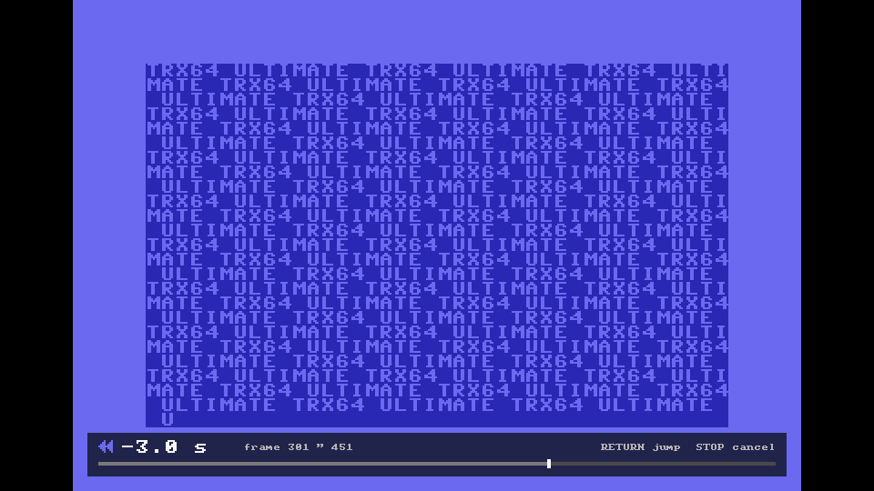

# 7. Timewarp

While the C64 runs, our bitstream records every change of the machine into memory, frame by frame.
You can go back to any recorded frame and continue from there.

How far back depends on what the program does: the ring holds a time window up to a size limit.
`trxmon`'s `rewind` command shows the range actually held.

The ring is off while the REU is on (they share the memory).

## The Timewarp bar

Set **Interface Type** to Freeze, open the menu, then **C64 Machine > Timewarp**. From the
Overlay menu it answers "Timewarp works from the menu over a frozen machine."

The picture shows the chosen frame; the bar shows how far back it is and the frame number.

| Key | Effect |
|---|---|
| Cursor left / right | One frame back / forward |
| Cursor up / down | One second back / forward |
| F1 / F7 | Ten seconds back / forward |
| HOME | The oldest frame |
| RETURN | Continue from this frame; the menu closes |
| RUN/STOP | Back to the menu; the machine continues where it was frozen |

Continuing from an older frame discards the later frames.

## From the monitor and over the network

`trxmon` has `rewind`, `frame`, `goto`, `rstep` and marks ([6.](06-monitor.md)). REST offers
`/v1/timewarp:status`, `:frame`, `:start`, `:stop`, `:rewind`, `:scrub` and `:scrubend`
([9.](09-network.md)).

## Saving the state and loading it back

**C64 Machine > Save State** writes the machine and the medium it is running into one `.c64re`
file: the newest frame the ring can go to, and the cartridge as it stands at that moment — with
everything the game has written into its flash, so a saved game inside the cartridge comes back
with the state. A progress box runs while it writes.

The file lands **beside the image that is running**: in the folder the cartridge was started from,
or that of the disk in drive A. With neither, it goes to `timewarp/` on the first of `/Usb0`,
`/Usb1`, `/SD` that is there. The name is `<image>-<date>-<time>.c64re`.

A 1 MB cartridge makes a file of about 1.2 MB; without a cartridge it is about 70 KB.

A save is refused with "Timewarp is off while REU is on" while the REU has the memory, with "The
ring holds no frame yet." before the ring has filled, and with "No USB stick or SD card to save to."
when there is nowhere to write. A write that fails leaves no file behind.

**A state is only written if it can be loaded back.** With a cartridge whose banking this release
cannot put back, the save is refused before the file exists: "A state of this cartridge (type XX)
cannot be loaded back yet." Those that can are EasyFlash, MegaByter, Ocean, Ocean 16K, Magic Desk,
Magic Desk 16, a plain cartridge, and GMod2 - whose saved game lives in its EEPROM and travels in
the file as a section of its own.

In the file browser a `.c64re` offers **Load State**, and it puts the machine the state needs back
together before putting the state into it:

- **The cartridge is inserted**, from the `.crt` the file names, and its flash is then the one from
  the moment of the save - what the game had written by then, not what is in the `.crt`. The
  machine is not reset on the way: nothing restarts, it carries on.
- **The disk is mounted** on drive A again, the same image, read-only if it was read-only. The
  drive's own state goes in after the mount.
- **The settings the state needs** - UCI, REU, the sampler - are set for as long as that state
  runs. Your own configuration is not written: the menu shows `set by the loaded state` on an item
  the state owns. They survive **Reset C64**, the way a cartridge in the port does, and end at
  **Reboot C64** or when you change the setting yourself.

If the `.crt` the file names is not where the file says, the same file name **in the folder the
`.c64re` lies in** is used instead - a state written on another computer names its cartridge by that
computer's path, so putting the two files in one folder is enough. Only that one folder is looked
in; is the image in neither place, the load is refused naming both and the running machine is left
alone. The disk image is found the same way. The state file is written beside the image it came
from, so the two normally travel together. A state of one cartridge will not go into a machine holding another: it
is refused with both types. Anything a load could not put back is named in a message once the
machine is running again.

With the menu over a frozen machine the file goes in when the menu closes, the way a rewind does.

Files from before this release still load. A `.c64rering` offers **Load State** as well and puts
the machine at the frame its cursor stands on; a `.trxring` offers **Load Ring** and brings the
whole ring back, so the same seconds can be rewound again — it is tied to the bitstream that wrote
it and says "A .trxring of another bitstream" when they do not match. Neither can be written any
more: one entry writes one state.

A file that carries this build's own chip block - Save State does - puts the machine back
exactly, the CPU registers and the CIA flip-flops included, so it runs on. A file without it, a dump
from the `c64re` app ([8.](08-apps.md)) for instance, comes back coarse: its nodes are laid on the
machine's own newest frame, so the ring has to be running ("No frame of this machine to build on:
let Timewarp run first"), and the debug log says what was not restored - the VIC's raster position
and pixel pipeline, the SID, the drive, and any keys the file had held down. A file for another
machine model is refused.
