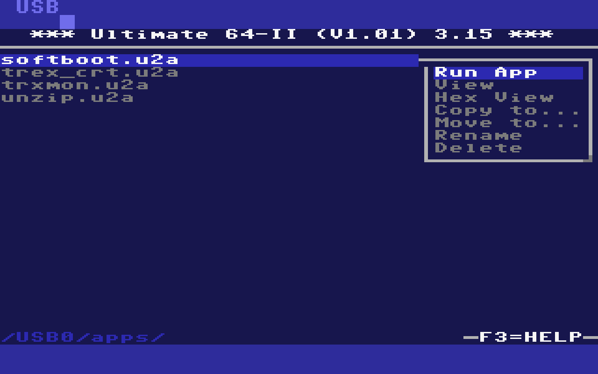
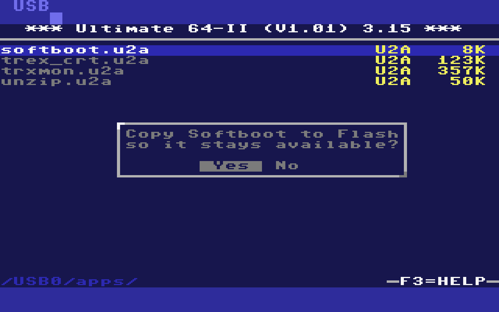
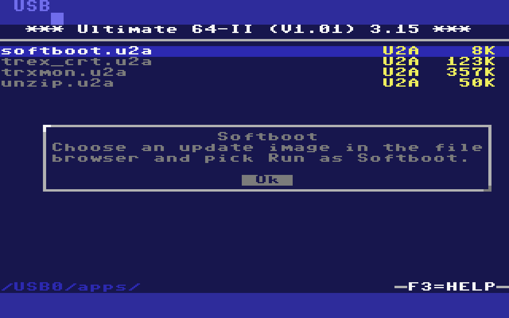
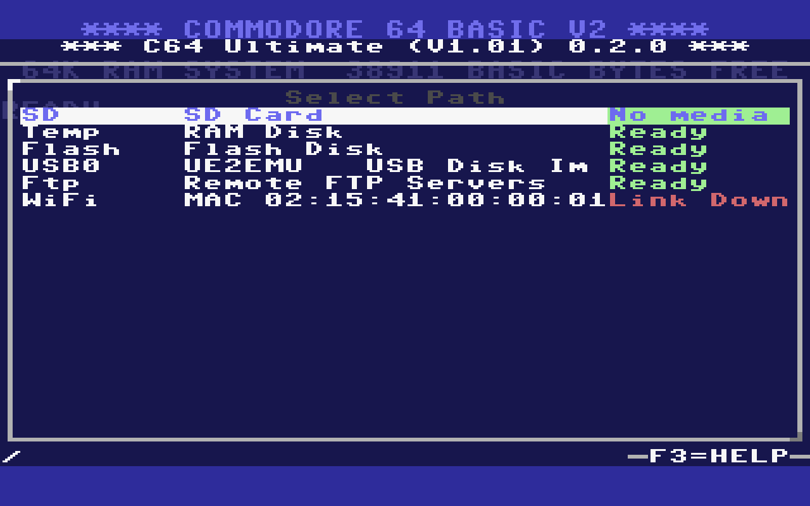
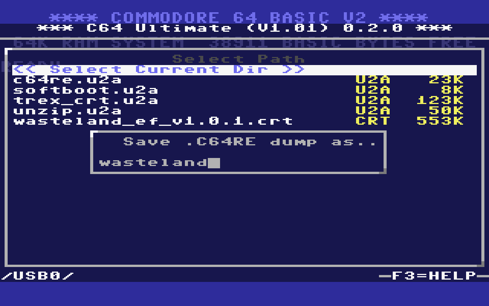
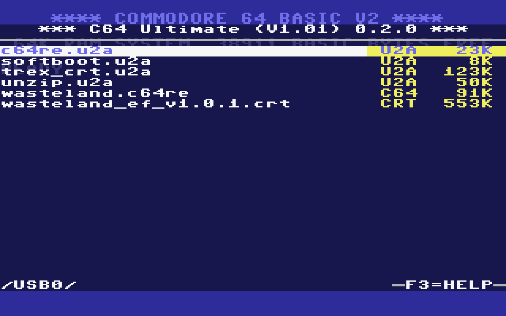

# 8. Apps

Functions beyond the base firmware come as apps: `.u2a` files that the firmware loads and runs.
Release 0.3.0 has four: `trex_crt` ([5.](05-cartridges.md)), `c64re`, `softboot` and `unzip`. The
monitor ([6.](06-monitor.md)) was one until it became part of the firmware.

## Installing

1. Put the `.u2a` files on a USB stick or SD card.
2. File browser: select the file, RETURN, **Run App**.

   

3. Answer **Yes** to "Copy <name> to Flash so it stays available?".

   

The app is now in `/Flash/apps` and registered: its entries appear in the action menu and in the
context menus of its file types, without the stick. Every `.u2a` in `/Flash/apps` is registered
again at each start. Running a different version from a stick asks "Update <name> on Flash with
this version?".

| App | Adds |
|---|---|
| trex_crt | C64 Machine > Dump Cartridge, Cart Inspector, Flash Cartridge; "Write to Cartridge" on `.crt` |
| softboot | "Run as Softboot" on `.cfw`, `.ue2`, `.u64` |
| unzip | "Unzip to folder", "Unzip here", "Extract one file" on `.zip` |
| c64re | C64 Machine > Save .C64RE Dump |

Apps run on the frozen machine; one at a time. Starting an app from the menu ends one that still
runs in the background. The monitor is no longer one of them: it is in the firmware, so it keeps its
breakpoints and its port while an app runs. An app that wants the debug block itself is refused
while a breakpoint or an observer is armed.

Messages when loading fails: "This is not a valid app file.", "This app needs a newer firmware.",
"This app was built for an older firmware. Please rebuild the app.", "The app file is damaged.",
"App not found, entry removed." (the file was deleted), "Medium not present." (its stick is not
plugged in).

## softboot

Starts the firmware of an update file from RAM, without writing the flash. The flash stays as it
is; a power cycle returns to the installed firmware. Used to try a new firmware.

**Run as Softboot** on the `.cfw` or `.ue2`:

1. "Verifying update file": the update must carry exactly the bitstream that is in the flash now.
   Otherwise: "This image brings another FPGA core than the one in flash. It can be flashed, not
   softbooted."
2. "Developer mode ... Continue?" Yes loads and starts it.

Started with Run App it only explains itself:

## c64re

Writes the machine as a `.c64re` file, the snapshot the TRX64 runtime of
[C64RE](https://github.com/Jondalar/C64ReverseEngineeringMCP) reads.

**C64 Machine > Save .C64RE Dump**, then a folder and a name.

The file lands in the chosen folder, `.c64re` appended if you leave it off.

What goes in is what the machine can honestly show while the menu holds it: the 64 KiB of RAM, the
colour RAM, the CPU port, the VIC registers, and the media that are in the machine. The 6510's own registers and the internal counters
of VIC, CIA and SID are on no bus and are left out, so the file opens as a machine to look at, not as
one that carries on running.

The file is a `C64RESNP` container: a format byte, a sha256 over the body, then the snapshot as
gzip'd JSON.

A real cartridge in the expansion port is not read reliably yet: the bus read the app uses can hang
with one plugged in, and the dump can still name a cartridge image that is no longer the one in the
machine. The browser does load a `.c64re` back (**Load State**), but a dump from this app carries no chip
block, so it comes back coarse: its nodes are laid on the machine's own newest frame, which means
the Timewarp ring has to be running, and the debug log lists what was not restored
([7.](07-timewarp.md)).

## unzip

| Entry on a `.zip` | Effect |
|---|---|
| Unzip to folder | Into a new folder next to the zip, named after it (`games.zip` -> `games`, then `games_1` ...) |
| Unzip here | Into the zip's folder |
| Extract one file | Lists the files; extracts the chosen one next to the zip |

Existing files are overwritten without asking. Entries with unsafe names (absolute paths, `..`)
are skipped and counted in the final message.
