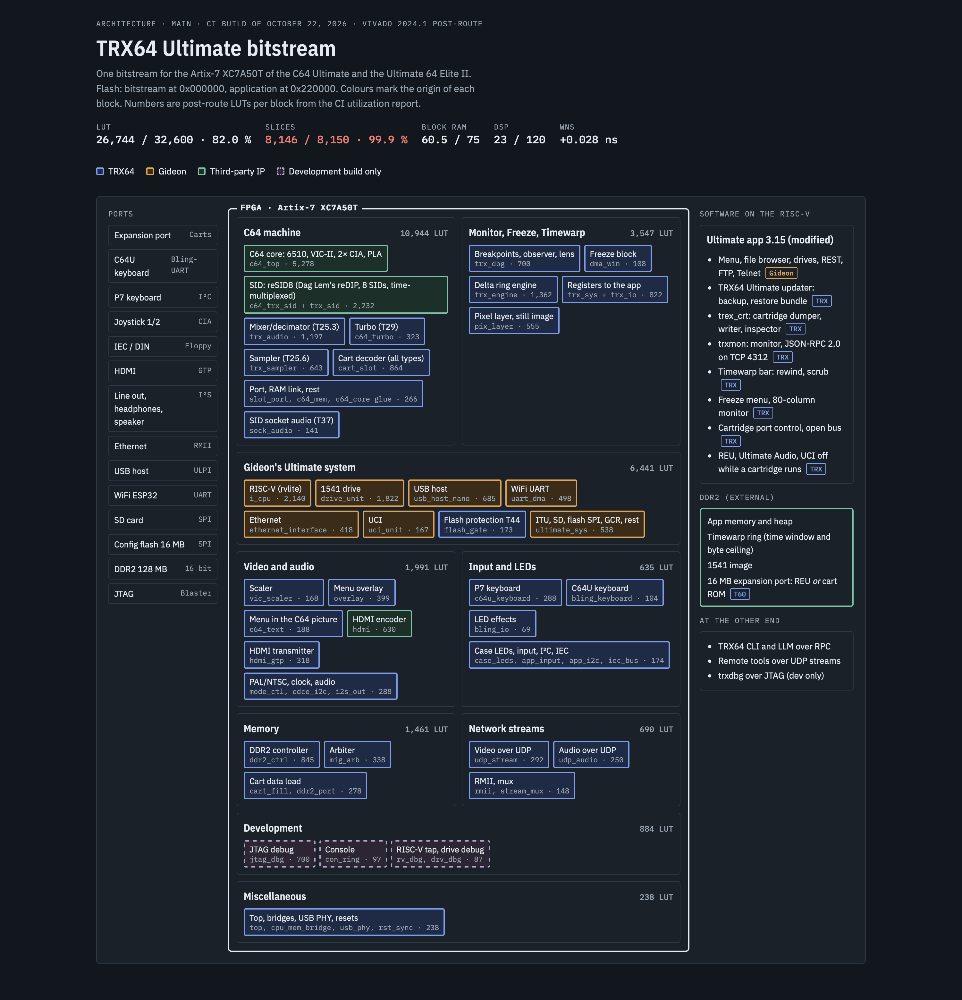

# Architecture

One bitstream for the XC7A50T. It has two halves that share the DDR2 memory: the **C64 half**
(the machine itself plus the TRX64 functions) and the **Ultimate half** (Gideon's system around
the RISC-V CPU that runs the Ultimate application). The application talks to the C64 half
through register blocks; the C64 half never depends on the application to run.

Colours: blue = TRX64, orange = Gideon, green = third-party IP, dashed = development build only.
Numbers are post-route LUTs from the CI build of 2026-10-22; see [Resources](Resources.md).

## The cut

**Kept from Gideon's Ultimate** (GPL-3, vendored from `fpga/` of his repository): the RISC-V
CPU (rvlite) with its busses and boot ROM frame, the 1541 drive, USB host, Ethernet, SD, the
WiFi UART, UCI, the ITU (timers, interrupts), the flash interface, GCR. The application on top
is Gideon's Ultimate application 3.15, modified: menu, file browser, drives, REST, FTP and Telnet
are his.

**New (TRX64)**:
- The C64 machine: grown from icepi-zero-c64 and now our own code. 6510 core (Gideon's 6502n,
  extended with state and load ports), VIC-II from vicii-kawari, CIAs and SID from Dag Lem's
  reDIP, all extended with a state bus so the machine can be read and restored.
- reSID8: up to 8 SIDs time-multiplexed on reDIP SID, our own mixer and our own sampler
  (Ultimate Audio compatible). Written clean-room: Gideon's UltiSID, Copper and filter are not
  used.
- Generic cartridge decoder driven by a mapping descriptor, the expansion port with real
  cartridges, REU up to 16 MB.
- Turbo: the 6510 at up to 63 cycles per C64 cycle.
- Monitor hardware (breakpoints, observers, cycle stop), freeze, the Timewarp delta ring engine,
  the pixel layer and still image, the register blocks the application uses.
- Our own DDR2 controller and arbiter (Xilinx MIG is no longer built), scaler, 1080p HDMI,
  keyboard and LED drivers, UDP video and audio streams, JTAG debug access.

**Left out** (deliberately): analog video out, UltiSID, Copper, the LED strip and lighting
effects, drive B, 1571 and 1581, the tape port. Gideon's unmodified application does not run on
this bitstream; it runs with its own.

## Paths through the chip

### Video

The VIC-II produces the C64 picture; the scaler brings it to 1080p (PAL 50 Hz, NTSC 60 Hz,
PAL-60, NTSC-50). The menu overlay (Gideon's character generator), the menu in the C64 picture
and the pixel layer (RGB565 over the C64 picture, still image) are mixed in before the HDMI
encoder. The same picture can go out as a UDP stream.

### Breakpoint to monitor

A breakpoint, an observer stop, a step or a cycle step all end the same way: **a stop is a
freeze**. The monitor hardware stops the whole machine (CPU, VIC, CIAs, SID, drive) at an
instruction or cycle boundary; the application then reads the state through the lenses
(side-effect-free reads of memory, registers and devices) and shows it in `trxmon`, on the
screen or over the RPC interface (JSON-RPC 2.0 over WebSocket, TCP port 4312, the TRX64 method
names, so C64RE connects to the device as to the TRX64 emulator).

### Timewarp

While the C64 runs at 1 MHz, the ring engine writes every change of the machine state as a delta
into DDR2, with a keyframe at regular intervals (default every 250 frames). The depth is bounded
by a time window and a byte ceiling; the monitor reports the depth actually held. Rewind and
scrub restore a frame from keyframe plus deltas; the machine can run forward from any frame. The
instruction trace of the last second gives the history per cycle, the last writers of an address
and the causal chain to a wild PC.

## Memory

DDR2, 128 MB, 16 bit, shared through one arbiter by the application (code and heap), the 1541
(image and ROM), cartridge ROM data, the 16 MB expansion area (REU or cartridge ROM, never both
at once) and the Timewarp ring.

## Software

The Ultimate application runs on the RISC-V. Functions beyond Gideon's come as loadable apps
(`.u2a`) where possible: `trex_crt` (cartridge tool), `unzip`, `softboot`. 
The application's updater installs bitstream and application together and
writes a restore bundle first.
