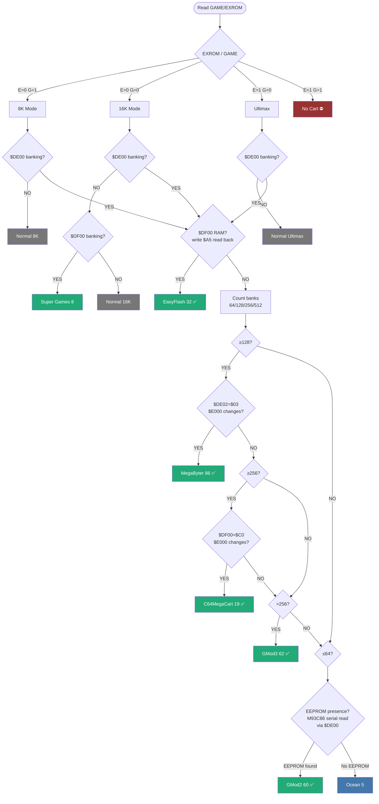

# Cart Type Detection Algorithm

The U64 Cart Dumper auto-detects physical cartridge types via DMA probing
of banking registers, RAM presence, flash autoselect, and bank-count wrap-around.

## Tests Performed (in order)

| # | Test | How | Cost |
|---|------|-----|------|
| T1 | GAME/EXROM | Read `U64_CART_DETECT` | Instant |
| T2 | $DE00 banking | Write bank 1, compare $8000 with bank 0 | Fast |
| T3 | $DF00 RAM | Write $A5 to $DF00, read back, restore | Fast |
| T4 | Bank count | Compare bank 0 with bank 64, 128, 256, 512 | ~2 sec |
| T5 | $DE02=$03 Ultimax | Write $03, check if $E000 changes, restore $00 | Fast |
| T6 | $DF00=$C0 Ultimax | Write $C0, check if $E000 changes, restore $00 | Fast |
| T7 | EEPROM presence | M93C86 serial read via $DE00 (replaces flash autoselect) | Fast |
| T8 | $DF00 banking | Write 0 then 1, compare $8000 (Super Games) | Fast |

## Decision Table

| Cart Type | CRT | T1 Mode | T2 $DE00 | T3 $DF00 RAM | T4 Banks | T5 $DE02 | T6 $DF00 | T7 Flash |
|-----------|-----|---------|----------|-------------|----------|----------|----------|----------|
| Normal 8K | 0 | 8K | NO | — | — | — | — | — |
| Normal 16K | 0 | 16K | NO | — | — | — | — | — |
| Normal Ultimax | 0 | Ultimax | NO | — | — | — | — | — |
| **EasyFlash** | 32 | any* | YES | **YES** | 64 | — | — | — |
| **MegaByter** | 86 | 8K | YES | NO | 128 | **YES** | — | — |
| **C64MegaCart** | 19 | 8K | YES | NO | 256 | NO | **YES** | — |
| **GMod2** | 60 | 8K | YES | NO | *unreliable* | NO | NO | **YES** (M93C86 EEPROM present) |
| **GMod3** | 62 | 8K | YES | NO | >256 | NO | NO | — |
| **Ocean/MagicDesk** | 5 | 8K | YES | NO | ≤64 | NO | NO | NO |
| Magic Desk 512K | 5 | 8K | YES | NO | 128 | NO | NO | NO |
| **Super Games** | 8 | 16K | NO | — | — | — | — | — |
| Ocean 16K | 5 | 16K | YES | NO | ≤64 | — | — | — |

*EasyFlash boots in Ultimax but may be frozen in 8K or 16K mode after
software switched $DE02.

## Detection Flow (Diagram)



## Detection Flow (Text)

```
1. Read GAME/EXROM pins
   → No cart (both high)? Stop.
   → Determines: 8K, 16K, or Ultimax mode.

2. Test $DE00 data-write banking
   → NO banking? It's a Normal cart (type 0). Stop.

3. Test $DF00 RAM (EasyFlash check)
   → Write $A5 to $DF00, read back.
   → Got $A5 back? It's EasyFlash (type 32). Stop.
   → No? Continue.

4. Count banks (wrap-around at 64/128/256/512)

5. If 16K mode:
   → Test $DF00 banking → Super Games (type 8)
   → Otherwise: Ocean 16K (type 5). Stop.

6. If banks ≥ 128:
   → Test $DE02=$03 (Ultimax at $E000)
   → Changed? MegaByter (type 86). Stop.

7. If banks ≥ 256:
   → Test $DF00=$C0 (Ultimax at $E000)
   → Changed? C64MegaCart (type 19). Stop.

8. If banks > 256:
   → GMod3 (type 62). Stop.

9. If banks ≤ 64:
   → EEPROM presence test: M93C86 serial read via $DE00
   → EEPROM found? GMod2 (type 60). Stop.
   → No EEPROM? Ocean / Magic Desk (type 5). Stop.

10. Fallback: Ocean / Magic Desk (type 5).
```

## Edge Cases

### EasyFlash appearing as 8K or 16K
EasyFlash boots in Ultimax mode but software can switch `$DE02` to 8K or
16K mode. When the U64 freezes the C64, we see whatever mode was active.
The $DF00 RAM test works regardless of the current mode because EasyFlash
RAM at $DF00 is **always visible**, even in kill mode.

### Magic Desk 512K (128 banks, no $DE02)
This cart has 128 banks like MegaByter but no $DE02 control register.
Step 6 tests `$DE02=$03` — Magic Desk 512K ignores this, `$E000` doesn't
change → NOT MegaByter → falls through to step 10 → correctly identified
as Ocean/Magic Desk (type 5).

### GMod2 bank count unreliable
GMod2 uses bits 6 and 7 of `$DE00` as control signals (bit 6 = EEPROM
select / EXROM high, bit 7 = flash write-enable), not banking bits. Writing
values ≥64 to `$DE00` activates these control signals rather than selecting
higher banks, making bank-count wrap-around detection unreliable. Detection
uses the M93C86 EEPROM presence test instead.

### EasyFlash without EAPI
A freshly erased EasyFlash has no EAPI signature in ROM, but the $DF00
RAM is always present. The RAM test catches this. EAPI at `$F800` can be
checked as a bonus confirmation but is not required.

## Why $DF00 RAM is Definitive for EasyFlash

| Cart | $DF00 behavior | Read-back of written value? |
|------|----------------|---------------------------|
| **EasyFlash** | 256 bytes RAM | **YES** — always |
| MegaByter | Not decoded | NO — bus floating / $FF |
| C64MegaCart | Write-only control register | NO — returns previous bus value |
| Ocean / Magic Desk | Not decoded | NO — bus floating / $FF |
| GMod2 | Not decoded | NO — bus floating / $FF |
| Super Games | Write-only bank register | NO — returns previous bus value |

## False Positives Avoided

| Test (rejected) | False positive on | Why it failed |
|-----------------|-------------------|---------------|
| `$DE02=$07` ROMH@$A000 | MegaByter | MB interprets $07 as Ultimax too |
| `$DE02=$05` + banking | GMod2, Ocean | Multiple carts respond to $DE02 |
| `$DE00+1` addr-write | EasyFlash | EF decodes entire $DE00-$DEFF range |
| EAPI signature only | Empty EasyFlash | Erased EF has no EAPI but has $DF00 RAM |
| `$DE02=$02` kill test | — | Kill is one-way, not reversible without reset |
| Flash autoselect ($AA/$55/$90) | GMod2 | Some AM29F040B chips don't respond to autoselect; EEPROM test is definitive |

## Register Summary

| Register | Value | Effect | Used by |
|----------|-------|--------|---------|
| `$DE00` | 0-63 | Bank select | All banked carts |
| `$DE00` | bit 6 ($40) | EEPROM select, EXROM high | GMod2 |
| `$DE00` | bit 7 ($80) | Flash write-enable | GMod2 |
| `$DE02` | `$03` | Ultimax mode | MegaByter |
| `$DE02` | `$05` | Ultimax mode | EasyFlash |
| `$DE02` | `$07` | 16K mode | EasyFlash |
| `$DF00` | R/W | 256 bytes RAM | EasyFlash |
| `$DF00` | `$00` | 8K Normal mode (write-only) | C64MegaCart |
| `$DF00` | `$C0` | Ultimax mode (write-only) | C64MegaCart |
| `$DF00` | 0-3 | Bank select (write-only) | Super Games |

## CRT Hardware Type Numbers (VICE)

| ID | Name | Banks | Mode |
|----|------|-------|------|
| 0 | Normal | 1 | 8K / 16K / Ultimax |
| 5 | Ocean type 1 / Magic Desk | ≤64 | 8K / 16K |
| 8 | Super Games | 4 | 16K |
| 19 | Magic Desk / C64MegaCart | ≤256 | 8K |
| 32 | EasyFlash | 64 | Ultimax (boot) |
| 60 | GMod2 | 64 | 8K |
| 62 | GMod3 | 256-2048 | 8K |
| 86 | MegaByter | 128 | 8K |

## References

- CRT format: https://ist.uwaterloo.ca/~schepers/formats/CRT.TXT
- EasyFlash: https://skoe.de/easyflash/files/devdocs/EasyFlash-ProgRef.pdf
- GMod2: https://wiki.icomp.de/wiki/GMod2
- GMod3: https://wiki.icomp.de/wiki/GMod3
- GMod2 source: https://gitlab.icomp.de/icomp-oem/gmod2
- Magic Desk 512K: https://github.com/msolajic/c64-magic-desk-512k
- MegaByter: Protovision Technical Reference Manual (2026)
- C64MegaCart: Martin Piper Technical Reference Manual
